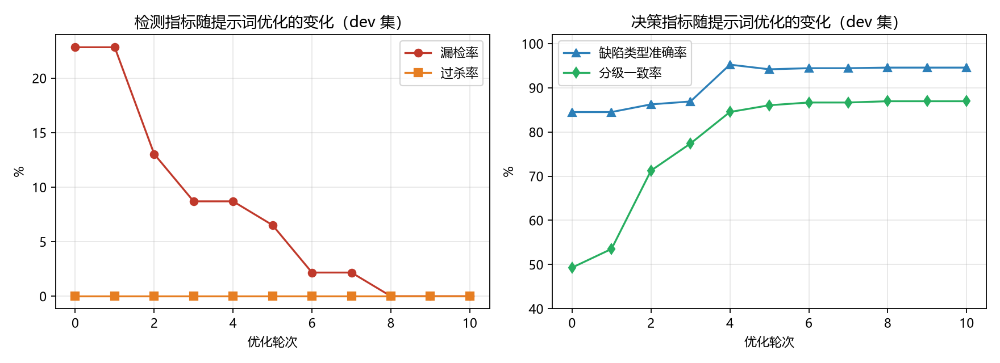
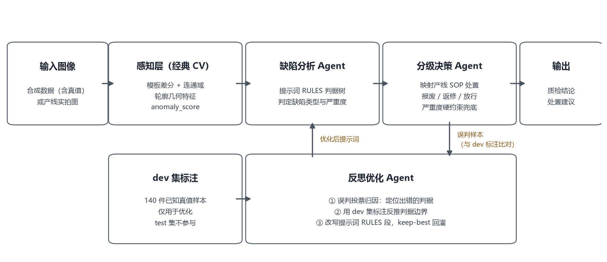

# 多智能体 + 提示词自动优化 · 螺丝/螺母工业质检 Demo

人工智能实践课程的结课项目。场景选了工业视觉质检（螺丝、螺母），方向是多智能体构建和提示词自动优化。

系统分了三层。经典 CV 做感知，把图像变成一组结构化特征；缺陷分析 Agent 判缺陷类型和严重度，分级决策 Agent 给处置建议；反思优化 Agent 拿 dev 集的误判做归因，看是哪条判据判错了，再用标注样本反推边界，改写提示词 RULES 段回灌。改一轮评一轮，指标不退步才保留，阈值不用人一条条去调。

---

## 1. 这个 Demo 解决什么问题

动手之前主要想了三件事：

1. 数据从哪来。产线级别的标注数据集不好找，这里用 OpenCV 程序化合成缺陷图像，生成的时候就带着 ground truth，仓库不依赖任何外部数据，谁跑结果都一样。
2. 为什么不让大模型直接看图。视觉大模型对多长算划痕、多大算缺料这类几何判据给不出稳定输出，同一张图两次问结果可能不同。所以看图这件事交给经典 CV，大模型只处理提取好的特征，做语义判断。
3. 提示词怎么调。阈值写死在提示词里，换一批光照或工件就失准，人工逐条改又慢又碰运气。所以做了自动优化闭环，让 Agent 自己从误判里学。

下面是 160 件独立 test 集上的实测（调优只用 dev 集，test 集最后才跑）：

| 方案                   | 漏检率    | 过杀率    | 类型准确率     | 分级一致率     | 综合准确率    | 万元损失     |
| -------------------- | ------ | ------ | --------- | --------- | -------- | -------- |
| 基线1：单模型·异常分阈值        | 1.8%   | 12.5%  | 不支持       | 不支持       | 95.0%    | 9.25 万元  |
| 基线2：多智能体·人工经验提示词     | 19.6%  | 0%     | 75.6%     | 50.0%     | 86.3%    | 68.75 万元 |
| 本方案：多智能体·提示词自动优化 | 0% | 0% | 82.1% | 75.0% | 100% | 0    |

单阈值基线如果按产线要求强制零过杀，漏检率会到 3.6%。本方案在零过杀的前提下把漏检压到了 0%，还额外给出缺陷类型和处置建议。

优化闭环跑出来的曲线：



---

## 2. 系统架构



四个部分各自干的事：

- 感知层：模板差分 + 形态学闭运算 + 连通域 + 轮廓几何，输出 `anomaly_score`、可疑区域数/面积/长宽比、几何畸变、面积偏差这些特征。它和提示词完全无关，提示词怎么改都不会影响特征提取。
- 缺陷分析 Agent：按提示词 RULES 段里的判据树判定 `defect_type` 和 `severity`。判据的顺序是有讲究的，先后变了结果会不一样。
- 分级决策 Agent：把缺陷映射到产线 SOP 处置（报废 / 返修 / 放行），严重度高的时候有硬约束兜底，防止 Agent 给出放行的危险建议。
- 反思优化 Agent：把 dev 集的误判归因到具体判据，用标注样本反推更合理的边界，改写提示词，只在复评指标不更差时才接受（keep-best），所以优化曲线是单调的，不会越改越差。

算力上不需要 GPU。感知层纯 CPU，单件 1.4 毫秒左右；优化闭环只跑 Agent、不重算特征，10 轮下来几秒钟。

### 2.1 感知这块比较过的三条路

动手前在图像怎么变成判据这件事上比较了三种做法，最后用了第三条。

一是直接让视觉大模型判。开发最快，但同一张图问两次结论可能不一样，它也说不清划痕多长才算缺陷，这条线画在哪没有交代，判错了也没法调。放弃。

二是预训练异常检测模型，PatchCore 那一类。检出能力比手写 CV 强，但要有 GPU，每个品类还得先备两三百张良品图建特征库，而且它只给一个异常分数，缺陷类型和处置建议还得再接一层判断。所以没当主方案用，只留作上真产线时的替换路径，见第 7 节。

三是经典 CV 做感知、多智能体做判断。模板差分、连通域、轮廓几何都能在 CPU 上跑，单件 1.4 毫秒，判据写成人能读的规则段，改的时候知道改的是哪一条。代价是只适用于夹具定位的工件，工件姿态一变就得先做配准。

依赖版本写在 `requirements.txt` 文件头，关键参数集中在两处，`qc_demo/perception.py` 里的模板差分阈值和形态学核大小，`qc_demo/agents.py` 里 RULES 段的各缺陷几何判据。要调直接改这两个文件。

---

## 3. 快速开始（本地）

命令都在终端里跑。先进入项目根目录，就是 README 和 `app.py` 所在的那个文件夹。

```bash
# 0. 进入项目根目录（路径按你机器上的实际位置改）
cd qc-multiagent-demo

# 1. 准备环境（推荐用自带 venv 或任意 Python 3.10+）
pip install -r requirements.txt

# 2. 跑实验（无 UI，直接出可抄进报告的表格 + 提示词演化）
python run_experiment.py

# 3. 或启动交互式 Demo
python app.py
# 浏览器打开 http://localhost:7860
```

没配置任何 LLM API 时会自动用内置的确定性模拟器，它从提示词 RULES 段读判据、按规则树判定，所以完全离线也能跑，结果可复现。想接真实大模型见第 6 节。

---

## 4. 在 AUP Learning Cloud 云端演示

AUP Learning Cloud（`tpe.aupcloud.io`）是 JupyterHub 那一套，登录后先看到的是 spawn 页。这个页面是让你挑镜像启动服务器的，按 Roscom 2026 / Teaching Labs / Development Environments 分组，不是终端，第一次进去容易找不着地方。

### 4.1 启动环境并打开终端

1. 在 spawn 页展开 Development Environments，选一个 CPU / Base CPU 环境（本 Demo 纯 CPU 就够，选 Roscom 2026 里的 GPU 课程镜像会白烧积分）。有 Code Server 环境的话优先选它，端口转发最方便。
2. 点中该资源 → 右侧 Launch Server → 等启动完成，自动进入 JupyterLab / Code Server。
3. 这时才有终端：
   - Jupyter Notebook（JupyterLab）环境：点左上 `+`（Launcher）→ 选 Terminal；或菜单 File → New → Terminal。
   - Code Server 环境：按 Ctrl + 反引号键（Esc 下面那个键）打开集成终端；或点左侧终端图标新建。

### 4.2 把项目传到云端（最容易漏的一步）

云端是另一台 Linux 机器（用户名一般是 `jovyan`），看不到你本地 Windows 上的任何文件。所以在云端终端里执行

```bash
cd C:\Users\zmm\...\qc-multiagent-demo      # 会报 No such file or directory
```

是必然失败的，云端没有 C: 盘，bash 里反斜杠 `\` 也不是路径分隔符。得先把代码传上去，下面三种方式选一种：

**方式 A：上传 zip（最简单，不需要 Git 账号）**

1. 本地把项目打包成 `qc-multiagent-demo.zip`。
2. 在云端环境里上传：
   - Code Server：把 zip 拖到左侧 EXPLORER 文件树里的 `JOVYAN` 那一行上（松手后右下角出现上传进度才算写进了磁盘）；或右键 `JOVYAN` / 文件树右上角 `...` → Upload...。
     - 注意，拖到右侧编辑器空白区不算上传，那只是打开这个文件（还会弹 Workspace Trust 提示），文件不会存盘。
   - JupyterLab：点左侧文件浏览器顶部的 ↑ 上传按钮，选 zip。
   - 上传后默认落在 `/home/jovyan/` 下。
3. 先确认文件真的在服务器上，再解压：

```bash
cd ~
ls -lh qc-multiagent-demo.zip     # 应显示约 1.2M；若没有此行，说明上传未成功

# 解压：优先用 Python 标准库（云端镜像常缺 unzip 命令）
python -m zipfile -e qc-multiagent-demo.zip .
# 若系统装了 unzip，也可用：unzip -q qc-multiagent-demo.zip -d .

cd qc-multiagent-demo
pwd && ls          # 确认能看到 app.py / requirements.txt
```

> 注意：AUP 云端容器默认没有 unzip 命令，直接执行会报 `bash: unzip: command not found`。用上面的 `python -m zipfile -e`（把 python 换成 python3 也行），它不依赖任何外部工具。
> 如果 ls 找不到 zip，先定位：`find ~ -maxdepth 5 -name "qc-multiagent-demo*" 2>/dev/null`。

**方式 B：从 GitHub / Gitee 克隆（推荐，顺便满足开源要求）**

先把本地仓库推到 GitHub/Gitee（见文末第 10 节），然后在云端：

```bash
cd ~
git clone https://github.com/zml8088/qc-multiagent-demo.git qc-multiagent-demo
cd qc-multiagent-demo
```

**方式 C：云端直接新建文件逐个粘贴**（应急用，不推荐）

### 4.3 安装依赖并运行

确认当前目录里能看到 `app.py`。解压完照着下面这一段执行就行，`<用户名>` 换成你自己的，本课程环境是 `bjut_teach_077`：

```bash
cd ~/qc-multiagent-demo          # 路径以你实际解压/克隆的位置为准
ls                               # 必须看到 app.py、requirements.txt

python -m pip install -r requirements.txt

python -c "import cv2, gradio, numpy, matplotlib; print('deps OK')"   # 验证装进了当前 python

QCDEMO_ROOT_PATH=https://tpe.aupcloud.io/user/<用户名>/proxy/7860 python app.py
```

依赖为什么要这么装：用 `python -m pip` 而不是裸 `pip`，避免装到另一个解释器里。`-i` 参数不要加清华源，AUP Learning Cloud（容器是 Python 3.12 + pip 25.2）上官方 PyPI 是通的，清华源反而取不到包，加了会报 `Could not find a version that satisfies the requirement gradio>=4.0 (from versions: none)`。确实需要镜像的话换阿里云，`-i https://mirrors.aliyun.com/pypi/simple/ --trusted-host mirrors.aliyun.com`。

启动时还得告诉 Gradio 它挂在代理的哪个子路径下，不加的话页面能打开但所有组件都显示错误，右上角报 `Unexpected token '<'`：

```bash
# 把 <平台域名> 与 <用户名> 换成你自己的（本课程环境为 tpe.aupcloud.io / bjut_teach_077）
QCDEMO_ROOT_PATH=https://<平台域名>/user/<用户名>/proxy/7860 python app.py
```

本机跑（不是云端）直接 `python app.py` 就行，不需要这个变量。也可以用 `GRADIO_ROOT_PATH`，是同一个东西。端口不是 7860 的话，前缀里的端口要一起改，或者用 `PORT=xxxx` 指定。

#### 4.3.1 装不上依赖（`Could not find a version that satisfies the requirement gradio>=4.0`）

先跑三行把环境情况打出来：

```bash
python -V
python -m pip -V
python -m pip index versions gradio 2>&1 | head -5
```

判断方法：

- `pip index versions gradio` 能列出 `gradio (6.30.0)` 和一堆历史版本，说明官方源没问题，问题出在加的 `-i` 镜像上（本平台实测清华源返回空候选，去掉就行）。
- `python -V` 低于 3.10 的话，gradio 5/6 要求 ≥3.10，pip 会把所有版本过滤掉，得换新版解释器（见下）。
- pip 版本太旧（<20）：`python -m pip install -U pip setuptools wheel`。

正常安装（默认 PyPI，最稳）：

```bash
python -m pip install -r requirements.txt
```

确需镜像时换阿里云，别用清华源：

```bash
python -m pip install -r requirements.txt \
  -i https://mirrors.aliyun.com/pypi/simple/ --trusted-host mirrors.aliyun.com
```

若 Python 版本过低：用镜像里现成的新版解释器建 venv，例如

```bash
python3.11 -m venv ~/venv && source ~/venv/bin/activate
python -m pip install -U pip && python -m pip install -r requirements.txt
```


### 4.4 访问 Demo 页面

启动成功后终端会打印 `[i] 访问地址：https://.../proxy/7860/`，浏览器直接打开这个地址（末尾的 `/` 要带上）：

- Jupyter Notebook / Code Server 环境都走 jupyter-server-proxy，地址形如
  `https://tpe.aupcloud.io/user/<你的用户名>/proxy/7860/`
- Code Server 环境也可以从 PORTS（端口）面板里点 `7860` 右侧图标 → Open in Browser；没出现的话点 Add Port 填 `7860`。

（平台分配的域名如果不是 `tpe.aupcloud.io`，把上面主机名换成你实际登录的地址就行。）

#### 4.4.1 报 `Unexpected token '<'` 怎么办

页面框架能出来，但每个组件都显示错误，右上角红色提示 `Could not parse server response: SyntaxError: Unexpected token '<'`。原因是代理子路径没配对：代理把 `/user/<用户名>/proxy/7860` 前缀剥掉后转发，而 Gradio 前端仍以绝对路径 `/gradio_api/...` 直连域名根，收到的是平台的 HTML 页面，JSON 解析自然失败（`<` 就是 HTML 开头）。

解决办法就是按 4.3 用 `QCDEMO_ROOT_PATH=https://<域名>/user/<用户名>/proxy/7860` 重启。注意：

- 必须用完整 URL（带 `https://` 和域名），只给子路径时 Gradio 会用请求的 origin 拼接，在代理后面容易拼错；
- 前缀与实际访问地址必须完全一致（含端口、不带尾部斜杠）；
- 改完要 Ctrl+C 停掉旧进程再重启，浏览器强刷（Ctrl+Shift+R）。

Demo 有三个页签：

- ① 单件抽检：随机抽一件，展示原图、异常热力图、感知报告、分析/分级 Agent 输出，并和真值比对。
- ② 提示词自动优化：点页面上那个运行优化闭环按钮，实时画出漏检/过杀/类型/分级随轮次变化，旁边并排展示优化前后提示词和每轮反思日志。
- ③ 对照实验：一键生成单模型阈值、多智能体(人工)、多智能体(自动优化)三者的对照表。

---

### 4.5 样本数据在哪里？

这个项目没有现成的样本文件夹，样本是运行时用代码现生成的，仓库能轻一点，真值也不会错。

- 生成逻辑在 `qc_demo/synthetic_data.py`：`generate_one(part, defect, severity)` 生成单张，`generate_dataset(n, seed)` 生成成套。
- `app.py`、`run_experiment.py`、`make_figures.py` 里都是现场生成，比如 `generate_dataset(140, seed=7)`（开发集）和 `generate_dataset(160, seed=99)`（测试集）。种子固定，任何人跑出来都一样。
- 想看到图片文件的话，跑 `python tools/make_samples.py`，会在 `samples/` 下导出 26 张样本（命名 `件型__缺陷__严重度.png`）、一张 `grid.png` 总览图，以及记录真值的 `labels.csv`。仓库里已经附了一份导出结果，可以直接打开看。
- 报告用的样本拼图另有 `figures/fig2_samples.png`。
- 换真实数据（MVTec AD）时，把图像放到 `data/` 下（该目录已在 .gitignore 里），按第 7 节组织标签即可。

## 5. 目录结构

```
qc-multiagent-demo/
├── app.py                 # Gradio 三页签 Demo（AUP Cloud 演示入口）
├── run_experiment.py      # 无 UI 完整实验：基线 + 优化闭环 + 提示词演化
├── selftest.py            # 快速自检：优化闭环是否跑通并提升
├── diag.py                # 感知层诊断：打印各缺陷/严重度的特征分布，用于标定判据阈值
├── make_figures.py        # 生成报告用三张图
├── requirements.txt       # 依赖清单（文件头注明实测通过版本）
├── optimized_prompt.txt   # 优化后最终提示词（自动产出）
├── LICENSE                # MIT 开源许可
├── qc_demo/
│   ├── synthetic_data.py  # 程序化合成螺丝/螺母缺陷图像（含 ground truth）
│   ├── perception.py      # 感知层：模板差分 + 连通域 + 轮廓几何 + 热力图
│   ├── llm_client.py      # 可插拔 LLM 客户端（OpenAI 兼容）+ 内置模拟器
│   ├── agents.py          # 缺陷分析 / 分级决策 / 反思优化 三个 Agent
│   ├── pipeline.py        # 流水线、评测、优化闭环、单阈值基线
│   └── __init__.py
├── figures/
│   ├── fig0_architecture.png   # 系统架构图（由 tools/make_architecture.py 生成）
│   ├── fig1_optimization.png   # 提示词优化曲线
│   ├── fig2_samples.png        # 合成缺陷样本示例
│   └── fig3_feature_space.png  # 感知特征空间（良品/缺陷分布）
├── samples/                   # 导出好的样本图片 + 真值表（由 tools/make_samples.py 生成）
│   ├── screw__scratch__mild.png  # 命名规则：件型__缺陷__严重度
│   ├── grid.png                 # 26 张样本总览拼图
│   └── labels.csv               # 每张图的真值（part/defect/severity/grade）
├── tools/
│   ├── make_samples.py        # 把合成样本导出为图片（含总览图与 CSV）
│   ├── make_architecture.py   # 生成系统架构图 figures/fig0_architecture.png
│   ├── make_report_docx.py    # 把实践报告 Markdown 排版为 .docx（宋体/黑体/表格/页码）
│   └── publish.sh             # 一键绑 remote 并推送到 GitHub / Gitee
```

---

## 6. 接入真实大模型（可选）

设置环境变量即可切换到真实 LLM（OpenAI 兼容接口）：

```bash
export OPENAI_BASE_URL="https://你的接口地址/v1"
export OPENAI_API_KEY="你的key"
export OPENAI_MODEL="gpt-4o-mini"   # 或其它支持 JSON 输出的模型
python app.py
```

`llm_client.py` 会优先用真实 API；未配置时自动回退到内置模拟器（`LLMClient.real == False`）。

---

## 7. 用 MVTec AD 真实数据替换合成数据

本 Demo 的合成数据是夹具定位版（工件朝向固定，便于模板对齐），属于受控的简化设定。要迁移到 MVTec AD 的 `screw` / `nut` 类别，只需替换数据来源和感知层对齐这两块，Agent 与优化闭环可以原样复用：

1. 数据接入：用 MVTec 提供的 per-image ground truth mask 生成和 `synthetic_data.py` 相同结构的标签
   `{"part": "screw"/"nut", "defect": 类型, "severity": ..., "grade": ...}`，把图像与标签喂给 `pipeline.prepare()`。
2. 感知对齐：MVTec 工件姿态有变化，模板差分前要先做配准/对齐（比如基于关键点的仿射变换）。也可以直接把感知层换成预训练异常检测模型（PatchCore / PaDiM），只要它输出的特征字段和本 Demo 同名（`anomaly_score_pct`、`max_region_area`、`max_elongation`、`geo_distortion` 等），后面的流程就不用改。
3. 提示词优化：`optimize_loop` 在 dev 集上跑，最后在 test 集汇报，流程不变。这也是它比对着测试集手调更靠谱的地方。

反思 Agent 反推判据边界的逻辑在真实数据上同样适用，因为它只依赖标注样本的特征分布，和数据来源无关。

---

## 8. 报告图表索引

| 图  | 文件                               | 说明                                       |
| -- | -------------------------------- | ---------------------------------------- |
| 图0 | `figures/fig0_architecture.png`  | 系统架构图（感知层 + 三智能体 + 反思优化闭环）               |
| 图1 | `figures/fig1_optimization.png`  | 提示词自动优化曲线（漏检/过杀/类型/分级随轮次变化）              |
| 图2 | `figures/fig2_samples.png`       | 合成的螺丝/螺母缺陷样本（划痕、变形/色差、缺料、锈蚀，含机加工纹理与光照波动） |
| 图3 | `figures/fig3_feature_space.png` | 感知特征空间，良品与各类缺陷的分布边界                      |

实验的全部原始数字（表 1、表 2）由 `run_experiment.py` 一键复现，任何人均可验证。

---

## 9. 已知问题与避坑

复现实验和云端部署时踩过的坑，记在这里：

- dev / test 必须分离。优化只在 dev 上做，指标只在 test 上汇报，不然等于对着测试集调提示词，属于数据泄露。
- keep-best 回灌。每轮改写后复评 dev，指标不更差才接受，所以优化曲线单调不倒退。
- 目标函数偏向漏检。`_score()` 里漏检权重最高，因为工业上漏检等于不良品流出，代价最大。
- 随机种子。`run_experiment.py` 用 `seed=7`（dev）/ `seed=99`（test），复现请保持一致。
- Code Server 拖入 zip 后弹 `Do you want to allow untrusted files in this workspace?` 提示框：这是 VS Code 的 Workspace Trust 提示（打开工作区外部的文件前先问一下），不是报错。点 Open 即可；点 Open in Restricted Mode 会禁用扩展/调试，没必要。随后关掉被打开的 zip 标签页（二进制没法显示），在终端解压才是正解。
- 云端没有 unzip 命令：`bash: unzip: command not found` 很常见（镜像里没装）。用 Python 标准库解压：`python -m zipfile -e qc-multiagent-demo.zip .`。
- `cd xxx.zip` 会报 Not a directory：cd 只能进目录，zip 是文件。解压得到 `qc-multiagent-demo/` 目录后再 cd 进去。
- 云端页面全显示错误，右上角 `Unexpected token '<'`：代理子路径没传给 Gradio。用完整 URL 前缀重启：`QCDEMO_ROOT_PATH=https://<域名>/user/<用户名>/proxy/7860 python app.py`，详见 4.4.1。
- `ModuleNotFoundError: No module named 'cv2'`：依赖没装（或者 pip 和 python 不是同一个环境）。用 `python -m pip install -r requirements.txt` 装；报 `externally-managed-environment` 的话加 `--user`。装完用 `which python && which pip && python -m pip -V` 核对路径是否一致。
- `ERROR: Could not find a version that satisfies the requirement gradio>=4.0 (from versions: none)`：pip 从索引里拿不到任何候选版本。三种可能：① 镜像站不可用/被代理拦截（换回默认 PyPI 或换个镜像）；② 当前 Python 版本过低（gradio 5/6 要求 ≥3.10，gradio 4 要求 ≥3.8），先 `python -V` 确认；③ pip 版本太旧（`python -m pip install -U pip`）。排查顺序见 4.3.1。

---

## 10. 开源发布（GitHub / Gitee）

本地仓库已经初始化并提交（分支 `master`）。发布按五步走：建空仓库、准备令牌、推送、设为 Public、回填地址。最后一定要确认仓库是 Public，用无痕窗口打开链接能看到文件才算数。

### 10.1 第一步　在平台新建空仓库

GitHub　右上角 `+` → New repository，Repository name 建议填 `qc-multiagent-demo`，可见性先选 Private（检查无误后再转 Public）。Add a README file、Add .gitignore、Choose a license 这三项都不要勾，本地已有这些文件，勾了首次 push 会冲突。

Gitee　右上角 `+` → 新建仓库，路径填同名，同样不要勾选使用 Readme 文件初始化仓库这个选项。

### 10.2 第二步　准备令牌（不是登录密码）

GitHub 自 2021 年起不再接受账号密码推送，必须用 Personal Access Token。

GitHub　Settings → Developer settings → Personal access tokens → Tokens (classic) → Generate new token (classic)，Note 任意，Expiration 选 90 days，只勾 `repo` 一项即可。生成后**立刻复制保存**，离开页面就再也看不到。

Gitee　头像 → 设置 → 安全设置 → 私人令牌 → 生成新令牌，勾选 `projects`，同样只显示一次。

推送时终端会问两样东西，用户名填你的**账号名**，密码框粘贴刚才的**令牌**。粘贴后不回显是正常的，回车即可。

### 10.3 第三步　推送（两条路，选一条）

**方式 A　一键脚本（推荐）**

```bash
cd qc-multiagent-demo

# 只推 GitHub
bash tools/publish.sh <你的GitHub用户名>

# GitHub + Gitee 都推
bash tools/publish.sh <你的GitHub用户名> qc-multiagent-demo <你的Gitee用户名>
```

脚本会自动把分支统一为 `main`、绑定 remote、推送，并把 README 里的 `<用户名>` `<仓库名>` 占位符替换成真实地址。令牌仍由 git 交互式询问，脚本不读取也不保存。

**方式 B　手动执行**

```bash
cd qc-multiagent-demo

# GitHub
git remote add origin https://github.com/zml8088/qc-multiagent-demo.git
git branch -M main
git push -u origin main        # 口令处填 Personal Access Token

# Gitee（如需两个平台都发）
git remote add gitee https://gitee.com/zml8088/qc-multiagent-demo.git
git push -u gitee main         # 口令处填 Gitee 私人令牌
```

> 提示 `remote origin already exists` 说明之前绑过，先 `git remote remove origin` 再重来；提示 `failed to push some refs` 多半是建仓库时勾了 README，先 `git pull origin main --rebase` 合并后再 push。

### 10.4 第四步　设为 Public

GitHub　仓库页 → Settings → General → Danger Zone → Change visibility → Change to public。

Gitee　仓库页 → 管理 → 仓库设置 → 开源。

设完用**无痕窗口**（未登录状态）打开仓库地址，能看到文件列表即视为满足课程要求，建议截图留存。

### 10.5 第五步　核对地址回填

本仓库的地址已回填进 4.2 节的 `git clone` 示例与本文 10.3 方式 B；若以后更换仓库名或账号，把这两处连同 remote 地址一起改掉即可，改完提交并推送。

```bash
git add -A && git commit -m "docs: 回填开源仓库地址" && git push
```

---

